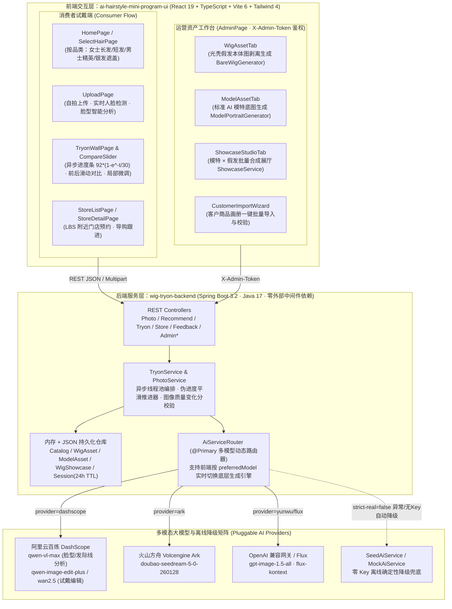

# AI 假发虚拟试戴全栈平台（AI Hairstyle & Wig Virtual Try-On Platform）

> **面向高端假发品牌与门店导购场景的 AI 虚拟试戴与三维资产编排系统。**  
> 包含 **移动端小程序/H5 消费者试戴工作台 + 运营级三层资产管理后台（`ai-hairstyle-mini-program-ui`）** 与 **可插拔多模型路由 Spring Boot 3 后端（`wig-tryon-backend`）**。支持零数据库离线种子演示（`seed` 模式），并可一键接入阿里云百炼（`qwen-vl-max` / `qwen-image-edit-plus`）、火山方舟（`doubao-seedream-5.0`）、OpenAI `gpt-image-1.5` 与 `Flux Kontext`。

---

## 1. 全栈系统架构图（System Architecture）

> 仓库内同时提供由 `archify` 生成的独立可交互 HTML 架构图：[docs/architecture/wig-tryon-architecture.html](docs/architecture/wig-tryon-architecture.html)



---

## 2. 核心工程亮点与技术深度梳理

### 2.1 独创「三层资产解耦架构」：彻底解决大模型试戴「把用户换脸」的行业顽疾
传统图生图（Image-to-Image）直接将“模特戴假发的商品图”与“用户自拍”融合时，大模型极易将模特的五官迁移到用户脸上（导致身份漂移 Identity Drift）。本项目在 `wig-tryon-backend` 中设计了严密的三层资产解耦机制：
1. **第一层 `WigAsset`（光秃假发本体层）**：通过 `BareWigGenerator` 将客户商品图中的人脸剔除，提炼出纯白色背景下的「无头模光秃假发本体图（`productImage`）」与结构化 Prompt 描述（`descriptionForAi`）。
2. **第二层 `ModelAsset`（标准模特底图层）**：通过 `ModelPortraitGenerator` 生成不同年龄段、脸型与肤色的标准模特肖像。
3. **第三层 `WigShowcase`（展厅合成层）**：在试戴时，`TryonService` 优先提取 `WigAsset` 的纯假发本体图与用户自拍融合，并配合 `DashScopeAiService` 的**下半脸变化分护栏（`faceMaxChangeScore`）**与**最小有效变化分重试机制（`minChangeScore`）**，确保**只换头发不换脸**，发丝根根分明、消除塑料蜡像感。

### 2.2 可插拔多模型路由器（`AiServiceRouter`）
业务代码仅依赖 `AiService` 接口，通过配置或前端传参 `preferredModel` 即可在 4 大引擎间无缝切换：
- **阿里云百炼（`DashScopeAiService`）**：使用 `qwen-vl-max` 进行正面人脸质检与脸型/发际线/白发比例分析；使用 `qwen-image-edit` / `qwen-image-edit-plus` 同步多模态接口或 `wan2.5-i2i-preview` 异步任务接口执行发区融合。
- **火山方舟（`VolcengineArkAiService`）**：直连字节跳动 `doubao-seedream-5-0-260128` 2K 高清生成。
- **云雾 OpenAI 兼容网关与 Flux（`YunwuOpenAiAiService` / `YunwuFluxKontextAiService`）**：支持 `gpt-image-1.5-all`、`flux-kontext` 单图保 ID 编辑。
- **零依赖种子降级（`SeedAiService`）**：默认支持无 API Key 启动，或在网络抖动时（`AI_STRICT_REAL=false`）自动降级至预制高保真种子效果图，保障门店与展厅演示 100% 不翻车。

### 2.3 连续感知伪进度推进曲线（Exponential Progress Ticker）
由于底层图像生成大模型不提供细粒度百分比回调，`TryonService` 内置了守护线程进度推进器，按指数衰减曲线平滑推进前端进度条：
$$\text{Progress}(t) = \min\left(92, \text{round}\left(92 \times \left(1 - e^{-t/30}\right)\right)\right)$$
前 30 秒快速推进至 58% 消除用户等待焦虑，后段平滑逼近 92% 等待真实大图落盘后瞬时跳至 100%。

---

## 3. 仓库目录结构

```text
.
├── ai-hairstyle-mini-program-ui/          # 前端：移动端试戴小程序 UI + 运营管理后台 (React 19 + Vite + TS)
│   ├── src/pages/                         # 消费者页面 (Home / SelectHair / Upload / TryonWall / StoreList / History)
│   ├── src/pages/admin/                   # 运营工作台 (WigAsset / ModelAsset / ShowcaseStudio / CustomerImportWizard)
│   ├── src/components/                    # 核心组件 (CompareSlider 前后对比滑块 / TryonHistoryDrawer 等)
│   └── src/hooks/                         # 状态编排 (useTryonStudio / useTryonHistory / useAdminAuth)
├── wig-tryon-backend/                     # 后端：Spring Boot 3 核心服务 (Java 17)
│   ├── src/main/java/com/wig/tryon/
│   │   ├── config/                        # 多模型配置属性 (DashScope / VolcengineArk / Yunwu / Admin 鉴权拦截器)
│   │   ├── controller/                    # C 端试戴接口与 B 端资产管理接口
│   │   ├── service/                       # 核心业务编排 (TryonService / PhotoService / BareWigGenerator 等)
│   │   ├── service/ai/                    # 多模型 AI 路由层 (AiServiceRouter / DashScope / Ark / Yunwu / Seed)
│   │   ├── repository/                    # 内存与 JSON 文件持久化仓库
│   │   └── model/                         # 领域模型与 DTO
│   ├── data/                              # 假发库、模特库、展厅 JSON 数据与环境变量模板
│   └── scripts/                           # 客户图册批量导入 Python 脚本与一键启动脚本
└── docs/                                  # 架构图与详细设计文档
    ├── architecture/wig-tryon-architecture.html  # 交互式系统架构图 (HTML)
    ├── VS-MPV.md                          # 产品 MVP 需求与架构设计基线
    ├── wig-asset-system-design.md         # 三层假发资产系统设计文档
    └── ai-prompts.md                      # 脸型分析与发丝级试戴 Prompt 工程规范
```

---

## 4. 核心 REST API 一览

| 领域 | 方法 | 路径 | 说明 |
| :--- | :--- | :--- | :--- |
| **照片与人脸** | `POST` | `/api/photo/upload` | 上传自拍（Multipart `file`），执行人脸检测并返回 `sessionId` |
| **智能推荐** | `GET` | `/api/recommend/analyze/{sessionId}` | 调用视觉模型分析脸型/发际线/肤色并返回匹配假发款式 |
| **商品目录** | `GET` | `/api/recommend/products` | 按分类（`category`）或脸型（`faceType`）查询假发商品列表 |
| **虚拟试戴** | `POST` | `/api/tryon/submit` | 提交异步试戴任务（支持指定 `preferredModel` 与局部微调指令） |
| **任务轮询** | `GET` | `/api/tryon/status/{taskId}` | 查询实时进度 `progress`、生成图 `resultImageUrl` 与质量评分 |
| **局部重绘** | `POST` | `/api/tryon/adjust` | 对不满意部位（刘海长度、发际线高度、蓬松度）二次微调生成 |
| **门店与反馈** | `GET` | `/api/store/nearby` | 获取附近合作假发定制门店列表及预约详情 |
| **资产后台** | `ALL` | `/api/admin/**` | 假发本体库、AI 模特库、展厅合成与客户画册批量导入（需 `X-Admin-Token`） |

---

## 5. 本地快速启动指南（零数据库依赖，5 分钟跑通）

### 5.1 启动后端（`wig-tryon-backend`）

**方式 A：零配置离线种子模式（无需任何 API Key，开箱即用）**
```bash
cd wig-tryon-backend
AI_MODE=seed mvn spring-boot:run
# 服务监听 http://localhost:8080
```

**方式 B：接入真实大模型（阿里云百炼 / 火山方舟 / 云雾）**
```bash
cd wig-tryon-backend
cp data/demo-recording.env.example data/demo-recording.env
# 编辑 data/demo-recording.env 填入你的 DASHSCOPE_API_KEY / ARK_API_KEY / YUNWU_API_KEY
./scripts/start-demo-recording.sh
```

### 5.2 启动前端（`ai-hairstyle-mini-program-ui`）

```bash
cd ai-hairstyle-mini-program-ui
npm install
npm run dev
# 浏览器打开 http://localhost:3000 即可体验完整试戴流程与 /admin 运营工作台
```

---

## 6. 开源协议（License）

本项目采用 [MIT License](LICENSE) 开源。
