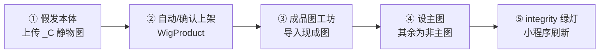
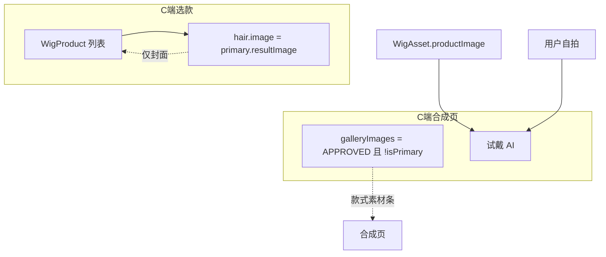

# 假发资产流程整改 — 设计说明 v2

> **状态**：已确认（Q1=A · Q2=C）— MVP 已实现  
> **演示目标**：领导演示 — 运营手工上传本体 + 成品图，C 端选款 / 试戴链路清晰  
> **关联**：`docs/wig-asset-system-design.md`、`docs/demo-category-tab-design.md`

---

## 0. 一句话本质

**一款假发 = 1 张本体图（AI 试戴唯一输入）+ N 张成品陈列图（1 主图 + 若干非主图款式素材）**；来源可以是运营手工上传或（后续）AI 合成，**混存于同一 wigAssetId**，C 端列表只看主图，合成页只看非主图；试戴永远 **用户自拍 + 本体图**。

---

## 1. 你已拍板的决策（设计基线）

| # | 决策 | 设计含义 |
|---|------|----------|
| D1 | 试戴 AI = **本体图 + 客户自拍** | `TryonService` 继续只读 `WigAsset.productImage`；成品图 / 主图 **永不** 作为推理输入 |
| D2 | 已有手工主图时，AI Tab 新图 **默认非主图** | `approve` / 生成完成时不自动 `markPrimary`；管理员可手动切换主图 |
| D3 | 同一款 **可混存** AI 与手工 showcase | 约束仅为 **同一 `wigAssetId`（同一本体）**；主图全局唯一，来源不限 |
| D4 | 清空现有 324 条 showcase 及批量导入脏数据 | 四类 JSON 重置为空，由运营重新上传 |
| D5 | **暂时不用模特库** | 演示主路径 = 成品图工坊「导入现成图」；AI Tab / 模特库 Tab 降级隐藏或置灰 |
| D6 | 后续运营统一上传本体 + 成品 | 不依赖 Python 批量导入脚本作为演示数据源 |

**关于 D3 的解读（请在下文 Q1 确认措辞无误）**  
「同一款可以 AI 主图 + 手工非主图（或反之）共存，只要试戴时共用同一本体图」——与 D2 不冲突：谁主谁次由 `isPrimary` 决定，可随时切换。

---

## 2. 资产模型（不变 + 最小约束）

```text
WigAsset（假发本体）                    每款 exactly 1 条
├── id
├── productImage          ← 唯一 AI 试戴参考（C 端不可见）
├── category              ← 短发 | 中长发 | 长发（+ tags 表卷度，见 §7）
└── name / descriptionForAi / tags ...

WigShowcase（成品陈列）                  每款 0~15 条
├── wigAssetId            ← 必填，关联本体
├── resultImage           ← C 端可见
├── isPrimary             ← 每 wigAssetId 至多 1 张 true 且 APPROVED
├── status                ← DRAFT | APPROVED | REJECTED
├── strategyUsed          ← customer-manual-import | dashscope | ...
└── modelAssetId          ← 可选；演示期恒为 null

WigProduct（C 端商品）                   与 WigAsset 1:1，id = wigAssetId
├── wigAssetId
├── category / name / tags ...
└── image                 ← 运行时由 RecommendService 替换为 primary showcase
```

### 2.1 关联不变量（integrity 规则）

| 规则 | 校验 |
|------|------|
| 本体必填 | 无 `productImage` → 禁止上架 / 禁止试戴 |
| 主图唯一 | 每 `wigAssetId` 最多 1 条 `APPROVED && isPrimary` |
| 本体 ≠ 陈列 | `productImage` URL ≠ 任一 `resultImage` |
| 商品存在 | C 端展示需有 `WigProduct.wigAssetId = WigAsset.id` |
| 试戴输入 | 仅 `WigAsset.productImage`，与 showcase 来源无关 |

---

## 3. 管理端工作流（演示期 · 无模特库）

### 3.1 推荐操作顺序



| 步骤 | 入口 | 行为 |
|------|------|------|
| ① 上传本体 | `#admin` → 假发本体 | 1 款 1 图；填 `category`、名称、AI 描述 |
| ② 上架商品 | **新增** 保存本体时同步写 `customer-catalog.json` | id = wigAssetId；避免 C 端看不到款 |
| ③ 导入成品 | 成品图工坊 → **导入现成图**（默认 Tab） | 1~15 张；首张可 `setFirstPrimary` |
| ④ 设主图 | 审核通过 + 「设为主图」 | 同款其余 `isPrimary=false` |
| ⑤ 校验 | integrity 面板 | 本体 ✓ / 商品 ✓ / 主图 ✓ / URL 不撞车 ✓ |

### 3.2 成品图工坊 Tab 策略（演示期）

| Tab | 演示期 | 后续 |
|-----|--------|------|
| **导入现成图** | ✅ 主路径 | 保持 |
| **AI 生成** | 🔒 隐藏或置灰 + 文案「需配置模特库后启用」 | 恢复；规则见 §4 |
| **客户批量导入向导** | 🔒 隐藏或置灰 | 可选保留给大批量 |

### 3.3 模特库 Tab

- 演示期：**导航隐藏**或只读空列表 + 说明「当前演示不使用 AI 合成陈列图」
- 数据：`model-assets.json` 清空为 `[]`

---

## 4. 主图 / 非主图 / AI Tab 规则（含 D2、D3）

### 4.1 设主图逻辑（统一）

```
markPrimary(showcaseId):
  同 wigAssetId 下全部 isPrimary ← false
  目标 showcase.isPrimary ← true（须 APPROVED）
```

管理员可在 **任意来源** 的已通过陈列图之间切换主图。

### 4.2 手工导入（Tab：导入现成图）

| 场景 | 行为 |
|------|------|
| 该款 **尚无** APPROVED 主图 | `setFirstPrimary=true` 时首张自动主图 |
| 该款 **已有** 主图 | 新导入全部 `isPrimary=false` |
| 审核 | 演示可 `autoApprove=true` 省步骤 |

### 4.3 AI 生成（Tab：AI 合成 · 后续启用）

| 场景 | 默认 isPrimary | 说明 |
|------|----------------|------|
| 尚无 APPROVED 主图 | **true**（审核通过时） | 首款 AI 图可当主图 |
| 已有手工主图 | **false** | 符合 D2 |
| 已有 AI 图（无论是否主图） | **false** | 新款 AI 不抢主图 |
| 管理员 | 可随时「设为主图」 | 覆盖默认 |

**Cardinality（后续可选收紧）**：每款 AI 路径建议最多保留 1 条 APPROVED；超出时提示「先删旧 AI 图再生成」——演示期可不 enforce。

### 4.4 AI 与手工混存（D3）

同一 `wigAssetId` 下允许：

```text
手工主图 + AI 非主图
AI 主图 + 手工非主图
全手工 / 全 AI
```

C 端与试戴 **只认 wigAssetId → 本体图**，不认 showcase 来源。

---

## 5. 小程序端展示与试戴

### 5.1 数据流



| 位置 | 字段 | 规则 |
|------|------|------|
| 选发型列表 / 素材库 | `image` | **仅主图**；无 primary 时回退占位图 + integrity 告警 |
| 合成页 / 放大弹窗「款式素材」 | `galleryImages` | **仅非主图** APPROVED；无则隐藏区块 |
| 试戴生成 | `TryonService` | `userPhoto + WigAsset.productImage` |

### 5.2 选款 Tab 分类（见 §7）

与资产整改 **独立但同期**：解决「卷发 Tab 无卷发 / 长发 Tab 有短发 / 重复」。

---

## 6. 数据清空与重建

### 6.1 清空范围

| 文件 | 操作 |
|------|------|
| `data/wig-showcases.json` | `[]` |
| `data/wig-assets.json` | `[]` |
| `data/model-assets.json` | `[]` |
| `data/customer-catalog.json` | `[]` |
| `data/storage/showcases/*` | 可选：清理旧文件（或保留孤儿文件不影响） |

**不清空**：门店种子、`/images/*` 占位图、内置 AI mock 资源。

### 6.2 避免「重启后又出现 15 条假商品」

**现状问题**：`CatalogRepository.seed()` 硬编码 15 条 `WigProduct`，再 overlay `customer-catalog.json`。  
清空 catalog 后 **重启仍会露出 15 条种子**，与「全部清空、自建数据」冲突。

**推荐改法（方案 R · 单选）**

| 方案 | 做法 | 取舍 |
|------|------|------|
| **R1（推荐）** | 商品 **仅** 来自 `customer-catalog.json`；`seed()` 只保留门店 | 最干净；空 catalog = 空选款页 |
| R2 | 保留 15 种子，但 id 段与运营 id 隔离 | 演示仍可能误点种子款 |
| R3 | 环境变量 `WIG_CATALOG_MODE=manual` 控制 | 多一个配置项 |

**采用 R1**：运营上传本体 → 同步写入 catalog → C 端只看到自己上的款。

### 6.3 重建 API

新增管理端能力（设计，/plan 实现）：

```
POST /admin/data/reset-demo-assets   # 一键清空四类 JSON + reloadFromDisk
POST /admin/wig-assets               # 已有；扩展为 save 时 upsert customer-catalog 行
```

---

## 7. 选款 Tab 分类整改（演示必做）

**问题根因**（已核实）：`category` 混用长度与卷度 + 推荐区不跟 Tab 过滤 + 同款上下重复。

### 方案对比

| 方案 | 内容 | 演示适用 |
|------|------|----------|
| **A+C（推荐）** | `category` 仅三长度；「卷发造型」用 tags 筛；修推荐去重 | ✅ 领导能听懂 |
| B+C | 四 Tab 互斥重排 metadata | 仍有「长卷归哪类」争议 |
| C alone | 只修前端重复 | ❌ Tab 仍乱 |

### A+C 规则摘要

- **category**：`短发 | 中长发 | 长发`（上传本体 / 上架时必选）
- **tags**：必含卷度信息之一，如 `直发` / `微卷` / `大卷` / `羊毛卷`
- **「卷发造型」Chip**：`tags` 匹配 `/卷|波浪|羊毛|慵懒/`
- **SelectHairPage**：推荐区跟 Tab 过滤；列表排除已在推荐区的 id

运营上传时在管理端 **强制选 category + 至少 1 个发型 tag**，避免再产脏数据。

---

## 8. 方案总览（2+1 档）

| 档位 | 范围 | 演示前耗时 |
|------|------|------------|
| **MVP（推荐）** | 清空数据 R1 + 本体/成品手工上传闭环 + gallery 不含主图 + Tab A+C 前端 + 隐藏 AI/模特/批量向导 | ~2–3h |
| **标准** | MVP + AI Tab 规则 §4.3 + integrity 强校验 + 管理端商品编辑 | +2h |
| **完整** | 标准 + 模特库 + 批量导入脚本对齐新规则 | 演示后 |

---

## 9. 演示验收标准

| # | 操作 | 预期 |
|---|------|------|
| 1 | 清空后打开小程序选款 | **0 条**（或仅运营刚上的款） |
| 2 | 管理端上传 1 本体 + 3 成品，设 1 主图 | integrity 全绿 |
| 3 | 小程序列表 | 只见 **1 张主图** / 款 |
| 4 | 点进合成页 | 款式素材 **2 张**（不含主图） |
| 5 | 发起试戴 | 后端日志 `使用 WigAsset productImage` |
| 6 | 切换主图为另一张 | 列表封面变，gallery 数量随之变化 |
| 7 | 短发 / 卷发 Tab | 无错类、无同款上下 duplicate |

---

## 10. 风险

| 风险 | 缓解 |
|------|------|
| 清空后 C 端空白 | 演示前预上传 4~8 款（每类 1~2 款） |
| 种子 15 条复活 | 必须做 R1，不能只做 JSON 清空 |
| 无本体仍上架 | integrity 阻断 + 试戴接口 400 |
| 领导问 AI 陈列 | 口播：「陈列图给看，试戴用本体图」+ 日志佐证 |

---

## 11. 待确认

### Q1 — D3 混存理解是否正确？

- **A.** 是：同一款可同时有 AI 与手工 showcase，**共用一个本体**；主图唯一、可切换（**推荐，按上文设计**）
- **B.** 否：同一款 **只能** 全 AI 或全手工，不能混存

### Q2 — 选款 Tab 采用哪种？（演示必做项）

- **A.** A+C：三长度 Tab + 卷发造型 Chip + 上传时规范 category/tags（**推荐**）
- **B.** B+C：四 Tab 互斥重分类 + 修重复
- **C.** 演示暂不改 Tab，只做空数据 + 上传闭环

---

**请回复 Q1、Q2 选项。确认后进入 `/plan` 拆实现任务；确认前不写代码。**
