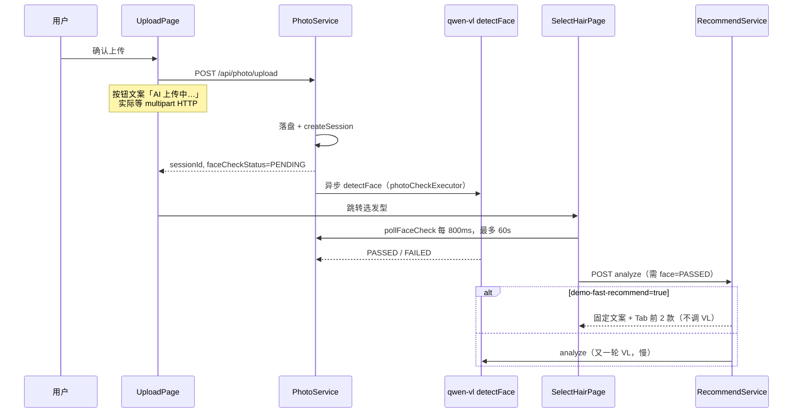

# 上传后「AI 上传中」卡顿 — 演示快速通道设计（v1）

> **状态**：已实现（见 `docs/superpowers/plans/2026-06-13-demo-fast-face-check.md`）  
> **关联**：`application-demo-recording.yml`、`RecommendService.demoFastRecommend`  
> **页面**：小程序 `UploadPage` → `SelectHairPage`

---

## 0. 一句话理解

用户点击「确认上传」后，前端文案写「AI 上传中…」，实际慢在 **上传完成后选发型页轮询百炼人脸检测（最多 60s）**；推荐分析已有 `demo-fast-recommend` 可跳过 VL，但 **人脸检测仍会调 qwen-vl**。演示阶段需新增配置项：**上传链路不调任何模型，人脸直接 PASSED + 固定结果**。

---

## 1. 现状链路（已核实）



### 1.1 各段耗时感知

| 阶段 | 是否调模型 | 用户看到 | 典型耗时 |
|---|---|---|---|
| multipart 上传 | 否 | UploadPage「AI 上传中…」 | 0.5~3s（大图/弱网更长） |
| 异步人脸检测 | **是**（qwen-vl） | SelectHairPage「人脸检测中…」 | **3~15s，偶发接近 60s** |
| analyze 推荐 | 已可跳过（`demo-fast-recommend`） | 「AI 分析中…」 | 开启后 <200ms |

**结论**：领导演示卡顿的主因是 **人脸检测**，不是上传 HTTP；UploadPage 文案「AI 上传中」有误导性。

### 1.2 已有能力

- `app.ai.demo-fast-recommend`（默认 `true`）：`RecommendService.demoFastRecommend()` 固定鹅蛋脸文案 + 按 Tab 推 2 款
- `application-demo-recording.yml`：录屏 profile 已开 `demo-fast-recommend`
- **缺失**：`PhotoService.uploadAndPreCheck` 始终 `FACE_PENDING` + 异步 `aiService.detectFace`

---

## 2. 目标

1. **演示可配置**：一条开关控制「上传后是否跳过人脸 VL」
2. **零模型调用**：开启后上传 → 选发型全程不调 qwen-vl（推荐沿用已有 fast recommend）
3. **真实链路可恢复**：关开关后行为与现网一致（异步检测 + 失败删图）
4. **不改试戴**：`TryonService` 仍走真实/seed 试戴，本设计只覆盖 **上传后 ~ 推荐前**
5. **最小改动**：不引入新依赖，不动 `AiService` 三实现接口

---

## 3. 方案对比

### 方案 A：独立配置 `demo-fast-face-check`（推荐）

新增 `app.ai.demo-fast-face-check`（env：`AI_DEMO_FAST_FACE_CHECK`）。

| 项 | 说明 |
|---|---|
| 开启时 | 上传接口同步写 `FACE_PASSED`，不提交 `photoCheckExecutor`，不调 `detectFace` |
| 关闭时 | 保持现有异步检测 |
| 与 recommend 关系 | **独立开关**；录屏 profile 两个都 `true` |

**优点**：语义清晰、可单独测人脸/推荐；与现有 `demo-fast-recommend` 对称。  
**缺点**：演示要开两个配置（可用 profile 一次搞定）。

### 方案 B：合并为 `demo-recording-mode` 总开关

一个 `app.ai.demo-recording-mode=true` 同时启用人脸跳过 + 快速推荐。

**优点**：运维只记一个开关。  
**缺点**：无法单独测「真人脸检测 + 假推荐」；要改 `RecommendService` 读新字段。

### 方案 C：前端纯跳过轮询（不推荐）

Upload 响应若 `PASSED` 则前端不 poll；后端仍异步调 VL。

**缺点**：analyze 可能在 VL 完成前报「检测进行中」；浪费 API 调用；治标不治本。

---

## 4. 推荐方案：A + 录屏 profile 打包

采用 **方案 A**，并在 `application-demo-recording.yml` 默认：

```yaml
app:
  ai:
    demo-fast-face-check: true
    demo-fast-recommend: true
```

`application.yml` 默认建议：

```yaml
demo-fast-face-check: ${AI_DEMO_FAST_FACE_CHECK:true}   # 与 recommend 一致，演示友好
demo-fast-recommend: ${AI_DEMO_FAST_RECOMMEND:true}
```

> 若你希望 **生产默认严格验脸**，可把 `demo-fast-face-check` 默认改为 `false`，仅录屏 profile 开 `true`。见 §7 待确认项。

---

## 5. 后端设计

### 5.1 配置

`AppProperties.Ai` 新增：

```java
/** 演示模式：上传后不调用 detectFace，会话直接 FACE_PASSED。 */
private boolean demoFastFaceCheck = false;
```

### 5.2 PhotoService.uploadAndPreCheck

```text
if (demoFastFaceCheck) {
  sessionRepository.updateFaceCheck(sessionId, FACE_PASSED, null);
  result.faceCheckStatus = PASSED;
  result.message = "照片上传成功（演示模式，已跳过人脸检测）";
  // 不 photoCheckExecutor.execute(...)
} else {
  // 现有异步 detectFace 逻辑不变
}
```

**不读图送 VL**：demo 模式下可跳过 `readSafe(imageBytes)` 若仅用于 face check（可选微优化，非必须）。

### 5.3 SystemController `/api/system/ai-status`

新增只读字段（不含 Key）：

```json
{
  "demoFastFaceCheck": true,
  "demoFastRecommend": true
}
```

供前端决定是否轮询 / 展示「演示模式」角标（可选）。

### 5.4 三模式行为（硬约束：不动 AiService 接口）

| AI_MODE | demo-fast-face-check | 上传后人脸 | analyze |
|---|---|---|---|
| seed/mock/real | false | 异步 qwen-vl（real）或 seed/mock 实现 | 依 recommend 开关 |
| 任意 | **true** | **同步 PASSED，零 VL** | 依 recommend 开关 |
| 任意 | true + recommend true | **全程零 VL** | 固定 2 款 + 文案 |

试戴 `generateTryon`：**不受本开关影响**（演示仍可调百炼试戴）。

---

## 6. 前端设计

### 6.1 UploadPage 文案

| 现文案 | 改为 |
|---|---|
| `AI 上传中...` | `上传中...` |

避免用户以为上传 HTTP 在调大模型。

### 6.2 SelectHairPage 轮询优化

**路径 1（最小）**：后端 demo 模式返回 `faceCheckStatus=PASSED`，首轮 `pollFaceCheck` 即结束，**无需改前端逻辑**。

**路径 2（增强，可选）**：

- 启动时 `api.aiStatus()`，若 `demoFastFaceCheck` → `setFaceReady(true)`，**跳过 pollFaceCheck**
- 或 upload 响应带 `faceCheckStatus=PASSED` 时由父组件传入 `initialFaceReady`

推荐 **路径 1 足够**（首轮 poll <1s）；路径 2 可省 1 次 HTTP。

### 6.3 用户可见状态

demo 模式下选发型页可显示小标签：`演示模式 · 已跳过 AI 人脸分析`（可选，避免领导追问「怎么这么快」）。

---

## 7. 待确认项（请回复一项）

**Q1：`demo-fast-face-check` 在 `application.yml` 的默认值？**

- **A（推荐演示）**：默认 `true`，与 `demo-fast-recommend` 一致，开箱即快 — **已采用**
- **B（推荐生产）**：默认 `false`，仅 `demo-recording` profile 开 `true`

---

## 8. 实现文件清单（/plan 阶段）

| 文件 | 改动 |
|---|---|
| `AppProperties.java` | +`demoFastFaceCheck` |
| `application.yml` | +配置项 + env 变量 |
| `application-demo-recording.yml` | 显式 `demo-fast-face-check: true` |
| `PhotoService.java` | 分支：跳过异步 detectFace |
| `SystemController.java` | ai-status 暴露两 demo 开关 |
| `UploadPage.tsx` | 文案「上传中…」 |
| `client.ts` `AiStatus` | +可选字段（若做路径 2） |
| `SelectHairPage.tsx` | 可选：读 ai-status 跳过 poll |

**不改**：`AiService` / `MockAiService` / `SeedAiService` / `DashScopeAiService` 接口与 `PromptBuilder`。

---

## 9. 测试思路

1. `demo-fast-face-check=true`：上传 → 选发型 **<2s 出现推荐**，后端日志无 `[PhotoCheck]`、无 `detectFace`
2. `demo-fast-face-check=false`：行为与现网一致，异步 `[PhotoCheck] 通过`
3. `FACE_FAILED` 路径：仅 false 时可测（上传非人脸图应拒绝）
4. 试戴：任选一款提交，确认仍用 **用户图 + 本体图** 双图（与本设计无关但回归必测）

---

## 10. 确认后下一步

设计确认后执行 **`/plan`** → 实现 → 录屏 profile 验证端到端耗时。
